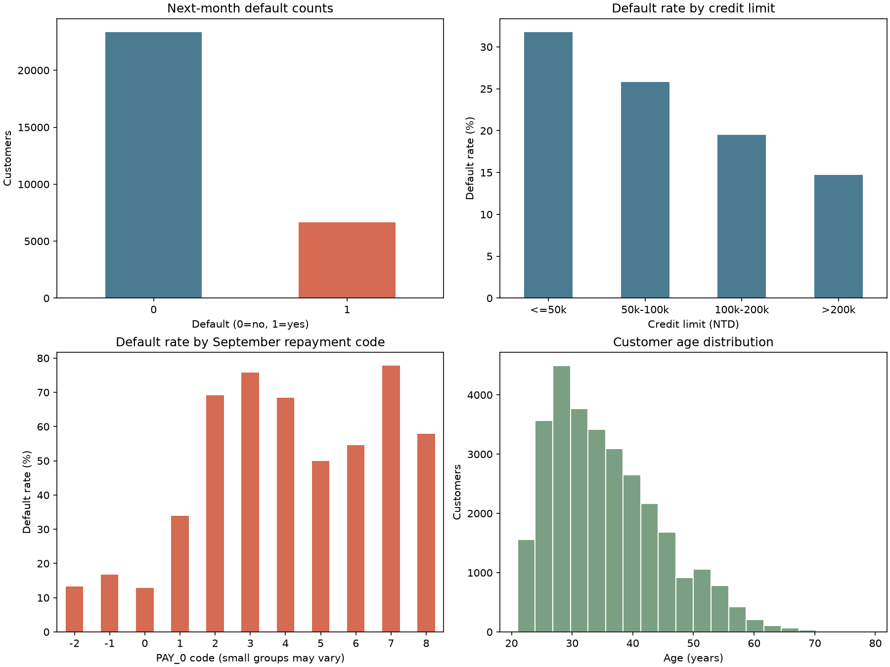
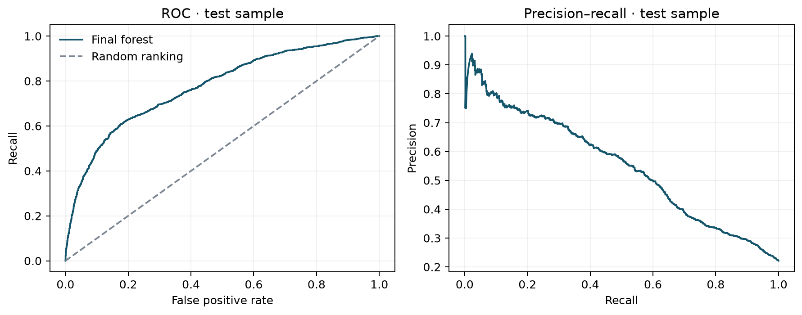
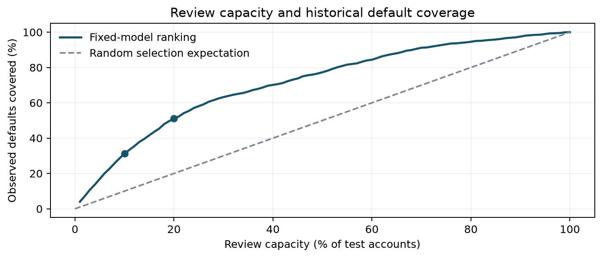
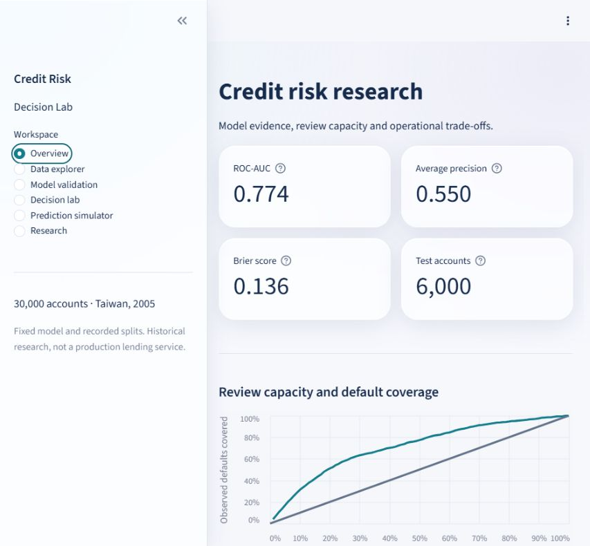

# Credit Risk Decision Lab: Predicting Credit Card Default and Resource-Constrained Risk Operations

[](https://www.python.org/)
[](https://scikit-learn.org/)
[](https://streamlit.io/)
[-blue.svg)](https://archive.ics.uci.edu/dataset/350/default+of+credit+card+clients)
[](https://creativecommons.org/licenses/by/4.0/)
[-brightgreen.svg)](tests/)

An end-to-end machine learning research framework and interactive decision system connecting credit card default prediction with capacity-constrained loan review and operational underwriting workflows.

---

## Contents

1. [Introduction and Background](#1-introduction-and-background)
2. [Exploratory Data Analysis](#2-exploratory-data-analysis)
   - [Dataset Overview](#dataset-overview)
   - [Feature Dictionary and Schema](#feature-dictionary-and-schema)
   - [Class Imbalance and Baseline Distribution](#class-imbalance-and-baseline-distribution)
   - [Payment Delinquency and Credit Line Signals](#payment-delinquency-and-credit-line-signals)
3. [Data Preprocessing and Compliance](#3-data-preprocessing-and-compliance)
   - [Leakage-Free Pipeline Architecture](#leakage-free-pipeline-architecture)
   - [Stratified Partitioning Protocol](#stratified-partitioning-protocol)
   - [Fair Lending and Demographic Attribute Exclusion](#fair-lending-and-demographic-attribute-exclusion)
4. [Supervised Machine Learning Models](#4-supervised-machine-learning-models)
   - [Evaluation Metrics and Mathematical Objectives](#evaluation-metrics-and-mathematical-objectives)
   - [Logistic Regression Baseline](#logistic-regression-baseline)
   - [Random Forest Classifier](#random-forest-classifier)
   - [Probability Calibration and Brier Score Analysis](#probability-calibration-and-brier-score-analysis)
   - [Resampling Stability and Bootstrap Uncertainty](#resampling-stability-and-bootstrap-uncertainty)
5. [Operational Decision Framework and Capacity Review](#5-operational-decision-framework-and-capacity-review)
   - [The Queue-Constrained Underwriting Problem](#the-queue-constrained-underwriting-problem)
   - [Cumulative Default Coverage and Queue Lift](#cumulative-default-coverage-and-queue-lift)
   - [Marginal Review Yield Analysis](#marginal-review-yield-analysis)
   - [Cost-Sensitive Thresholds and Expected Loss](#cost-sensitive-thresholds-and-expected-loss)
6. [Held-Out Evaluation Results](#6-held-out-evaluation-results)
7. [Interactive Research Workspace](#7-interactive-research-workspace)
8. [Repository Architecture](#8-repository-architecture)
9. [Quickstart and Reproduction Guide](#9-quickstart-and-reproduction-guide)
10. [Scientific Disclosures and Methodological Bounds](#10-scientific-disclosures-and-methodological-bounds)
11. [References and Attribution](#11-references-and-attribution)

---

## 1. Introduction and Background

During 2005 and 2006, the consumer credit market in Taiwan experienced a structural expansion in unsecured revolving credit and cash cards. In aggressive efforts to capture retail market share, card-issuing institutions significantly lowered credit standards, granting multi-card credit limits to applicants regardless of verifiable debt servicing capability. Consequently, consumer debt accumulated beyond sustainable repayment thresholds, culminating in widespread consumer delinquencies and severe bank credit losses.

In risk operations, credit default modeling encounters two interrelated challenges that abstract academic classification benchmarks frequently overlook:

1. **Discrimination versus Probability Calibration**: Maximizing a threshold-independent ranking metric like Area Under the ROC Curve (ROC-AUC) does not ensure that the model output reflects a reliable posterior probability. In modern credit risk frameworks (such as Basel II/III Internal Ratings-Based approaches), downstream loss estimates directly rely on calibrated Probability of Default ($PD$) values:
   $$\text{Expected Loss } (EL) = PD \times LGD \times EAD$$
   where $LGD$ denotes Loss Given Default and $EAD$ denotes Exposure at Default.
2. **Operational Queue Capacity**: A retail credit operations desk cannot audit every suspicious transaction or manually re-underwrite every delinquent borrower. Human verification units operate under rigid daily queue budgets (e.g., resources to manually inspect at most 10% to 20% of active accounts). A binary classification threshold like $p \ge 0.5$ fails in production when it flags either too few cases or overwhelms operational staff with false alarms.

**Credit Risk Decision Lab** addresses this operational reality by formulating credit risk scoring as a constrained resource allocation problem. Rather than treating accuracy as an end goal, this project evaluates how calibrated risk scores prioritize accounts under operational review constraints.

---

## 2. Exploratory Data Analysis

### Dataset Overview

The study utilizes the benchmark **Default of Credit Card Clients** dataset from the UCI Machine Learning Repository, compiled by I-Cheng Yeh (Chung Hua University). The dataset consists of **30,000 observations**, each representing an individual account holder in Taiwan from April 2005 to September 2005, with payment outcome tracked for October 2005.

### Feature Dictionary and Schema

The feature vector contains 24 raw attributes organized into customer background, repayment tracking, billing records, and historical payment transactions:

| Feature Name | Variable Type | Measurement Domain | Role in Modeling Pipeline |
|:---|:---|:---|:---|
| `LIMIT_BAL` | Numeric | Total approved credit limit in New Taiwan Dollars (NTD) | Core Exposure Measure |
| `SEX` | Categorical | Gender indicator (`1` = Male, `2` = Female) | **Excluded for Fair Lending Compliance** |
| `EDUCATION` | Categorical | Educational attainment (`1` = Graduate School, `2` = University, `3` = High School, `4` = Others, `5`/`6` = Unknown) | **Excluded for Fair Lending Compliance** |
| `MARRIAGE` | Categorical | Marital status (`1` = Married, `2` = Single, `3` = Others) | **Excluded for Fair Lending Compliance** |
| `AGE` | Numeric | Age in completed years | Demographic Control |
| `PAY_0` | Ordinal | Repayment delay status in September 2005 | Primary Predictive Risk Signal |
| `PAY_2` | Ordinal | Repayment delay status in August 2005 | Historical Delinquency Signal |
| `PAY_3` | Ordinal | Repayment delay status in July 2005 | Historical Delinquency Signal |
| `PAY_4` | Ordinal | Repayment delay status in June 2005 | Historical Delinquency Signal |
| `PAY_5` | Ordinal | Repayment delay status in May 2005 | Historical Delinquency Signal |
| `PAY_6` | Ordinal | Repayment delay status in April 2005 | Historical Delinquency Signal |
| `BILL_AMT1` | Numeric | Monthly statement balance in September 2005 (NTD) | Balance Exposure |
| `BILL_AMT2` | Numeric | Monthly statement balance in August 2005 (NTD) | Balance Exposure |
| `BILL_AMT3` | Numeric | Monthly statement balance in July 2005 (NTD) | Balance Exposure |
| `BILL_AMT4` | Numeric | Monthly statement balance in June 2005 (NTD) | Balance Exposure |
| `BILL_AMT5` | Numeric | Monthly statement balance in May 2005 (NTD) | Balance Exposure |
| `BILL_AMT6` | Numeric | Monthly statement balance in April 2005 (NTD) | Balance Exposure |
| `PAY_AMT1` | Numeric | Repayment amount remitted in September 2005 (NTD) | Repayment Velocity |
| `PAY_AMT2` | Numeric | Repayment amount remitted in August 2005 (NTD) | Repayment Velocity |
| `PAY_AMT3` | Numeric | Repayment amount remitted in July 2005 (NTD) | Repayment Velocity |
| `PAY_AMT4` | Numeric | Repayment amount remitted in June 2005 (NTD) | Repayment Velocity |
| `PAY_AMT5` | Numeric | Repayment amount remitted in May 2005 (NTD) | Repayment Velocity |
| `PAY_AMT6` | Numeric | Repayment amount remitted in April 2005 (NTD) | Repayment Velocity |
| `default payment next month` | Binary Target | Ground truth indicator: `1` = Default in October 2005, `0` = Timely Payment | Supervised Ground Truth Target |

*Data Hygiene Note: Repayment codes `-1` denote payment duly, while `1` through `8` denote consecutive months of overdue payment. Codes `0` and `-2` represent revolving credit usage and zero balance respectively; they are preserved as valid historical observations.*

### Class Imbalance and Baseline Distribution



The historical distribution reveals marked skewness:
* **Target Imbalance**: 23,364 accounts paid duly (77.88%), whereas 6,636 accounts defaulted (**22.12% base default rate**). A naive majority-class classifier achieves 77.88% accuracy while failing to capture any credit defaults.
* **Credit Line Dispersion**: Approved limits span from NT$10,000 to NT$1,000,000, with a median of NT$140,000 and mean of NT$167,484. Default rate correlates inversely with credit line size: accounts with $\text{LIMIT\_BAL} \le \text{NT}\$50,000$ exhibit a **31.79%** default rate, compared to **14.73%** for lines exceeding NT$200,000.
* **Account Age**: Customer ages range from 21 to 79 years, with a median of 34 and mean of 35.49 years.

### Payment Delinquency and Credit Line Signals

The most powerful predictor is `PAY_0` (September payment status):
* Accounts classified as paid duly (`-1`) or revolving balance (`0`) exhibit default rates below **15%**.
* Accounts with a 1-month delay (`PAY_0 = 1`, 3,688 accounts) exhibit a **33.95%** default rate.
* Accounts with a 2-month delay (`PAY_0 = 2`, 2,667 accounts) escalate to a **69.14%** default rate.

---

## 3. Data Preprocessing and Compliance

### Leakage-Free Pipeline Architecture

Data leakage in published machine learning benchmarks frequently occurs when preprocessing transformers (such as scalers or target encoders) are fitted across the entire dataset prior to splitting. In this repository:
1. Feature standardizers (`StandardScaler`) are computed strictly using the 18,000 training observations.
2. The empirical mean $\mu_{\text{train}}$ and variance $\sigma_{\text{train}}^2$ are fixed and applied out-of-sample to validation and test records without recalculation.

### Stratified Partitioning Protocol

The dataset is partitioned deterministically with stratification on the target variable:
* **Training Set**: 18,000 records (60% split, 3,982 defaults, 22.12% default rate)
* **Validation Set**: 6,000 records (20% split, 1,327 defaults, 22.12% default rate)
* **Held-Out Test Set**: 6,000 records (20% split, 1,327 defaults, 22.12% default rate)

The customer assignment mapping is persistently stored in `reports/data_split.csv` to ensure exact reproducibility across runtime environments.

### Fair Lending and Demographic Attribute Exclusion

Under regulatory fair lending principles (such as the US Equal Credit Opportunity Act and equivalent international guidance), algorithms should avoid relying on protected personal characteristics.

We conducted a comparative validation experiment:
* Model trained with all 23 predictors (including `SEX`, `EDUCATION`, and `MARRIAGE`): **Validation ROC-AUC = 0.7899**
* Model trained strictly with 20 non-demographic predictors: **Validation ROC-AUC = 0.7863**

Excluding SEX, EDUCATION, and MARRIAGE changed the reported validation AUC by 0.0036. The final 20-feature model still includes AGE. Excluding selected attributes does not establish fairness or eliminate proxy effects; group outcomes require further assessment.

---

## 4. Supervised Machine Learning Models

### Evaluation Metrics and Mathematical Objectives

Models are evaluated across complementary dimensions:

1. **ROC-AUC (Discrimination)**: Area under the Receiver Operating Characteristic curve measures ranking quality independent of classification threshold:
   $$\text{AUC} = \int_{0}^{1} \text{TPR}(\text{FPR}^{-1}(t)) \, dt$$
2. **Average Precision (PR-AUC)**: Summarizes precision across all recall cutoffs, sensitive to positive-class discovery under class imbalance:
   $$\text{AP} = \sum_{k} (R_k - R_{k-1}) P_k$$
3. **Brier Score (Calibration Reliability)**: Mean squared error between predicted probabilities $\hat{p}_i$ and observed ground truth $y_i \in \{0, 1\}$:
   $$\text{BS} = \frac{1}{N} \sum_{i=1}^{N} (\hat{p}_i - y_i)^2$$
   A lower Brier score represents better calibrated probabilities.

### Candidate Model Architectures

Three candidate configurations were fitted on the 18,000 training records:

1. **Baseline Logistic Regression**:
   - $L_2$-regularized penalized generalized linear model ($C=1.0$, `lbfgs` solver, max iterations 1000).
   - Produces monotonic log-odds estimates over standardized continuous features.
2. **Random Forest Classifier**:
   - Ensemble of 100 decorrelated decision trees (`n_estimators=100`).
   - Structural regularization: `min_samples_leaf=25` to constrain terminal leaf variance and prevent overfitting.
   - Non-linear feature interactions across multi-month payment histories.
3. **Sigmoid-Calibrated Random Forest**:
   - 3-fold internal stratified out-of-fold Platt scaling (fitting a logistic sigmoid transformation mapping raw forest votes to calibrated empirical frequencies).



### Validation Diagnostics

| Model Pipeline | Val ROC-AUC | Val Average Precision | Val Brier Score | Algorithmic Assessment |
|:---|:---:|:---:|:---:|:---|
| **Logistic Regression (Baseline)** | 0.7259 | 0.5001 | 0.1452 | Fast linear benchmark; lower recall on severe delinquencies |
| **Random Forest (Final Chosen)** | **0.7899** | **0.5642** | **0.1337** | Strongest discrimination and lowest probability error |
| **Calibrated Random Forest** | 0.7867 | 0.5598 | 0.1343 | Sigmoid calibration yielded no empirical improvement over raw forest |

### Resampling Stability and Bootstrap Uncertainty

* **3-Fold Cross-Validation on Training Set**: AUC scores across internal folds yielded values of **0.7875**, **0.7802**, and **0.7790**, demonstrating stable performance across distinct partitions.
* **Paired Validation Bootstrap (1,000 Iterations)**: Resampling validation records with replacement generated empirical 95% confidence intervals:
  - Random Forest ROC-AUC: $[0.7739, 0.8037]$
  - Random Forest Brier Score: $[0.1283, 0.1392]$

---

## 5. Operational Decision Framework and Capacity Review

### The Queue-Constrained Underwriting Problem

In operational practice, default prediction is used to allocate fixed investigator hours. An audit desk capable of reviewing $K$ accounts per period sorts all customers by model-predicted risk $\hat{p}_i$ descending and audits the top $K$ accounts.



### Cumulative Default Coverage and Queue Lift

Evaluating the test partition of 6,000 accounts (containing 1,327 actual defaults):

| Operational Review Capacity | Review Slots Allocated | Observed Defaults Captured | Default Coverage (Recall) | Queue Concentration Lift |
|:---:|:---:|:---:|:---:|:---:|
| **Top 5%** | 300 | 224 | 16.88% | **3.38x vs. Random** |
| **Top 10%** | **600** | **415** | **31.27%** | **3.13x vs. Random** |
| **Top 15%** | 900 | 552 | 41.60% | **2.77x vs. Random** |
| **Top 20%** | **1,200** | **678** | **51.09%** | **2.55x vs. Random** |
| **Top 30%** | 1,800 | 839 | 63.23% | **2.11x vs. Random** |

*Operational Takeaway*: Under random auditing, inspecting 600 accounts yields an expectation of $600 \times 0.2212 = 132.7$ defaults. Auditing the **top 10% model-ranked queue** uncovers **415 defaults** (a 3.13x lift). Expanding audit resources to **20%** captures **51.09%** of all defaulting borrowers.

### Marginal Review Yield Analysis

As capacity expands, marginal returns diminish:
* First 300 accounts (0% to 5%): **224 defaults captured** (74.7% precision)
* Next 300 accounts (5% to 10%): **191 defaults captured** (63.7% precision)
* Next 300 accounts (10% to 15%): **137 defaults captured** (45.7% precision)
* Next 300 accounts (15% to 20%): **126 defaults captured** (42.0% precision)

Beyond the 20% tier, each additional default detected requires reviewing substantially more non-default accounts.

### Cost-Sensitive Thresholds and Expected Loss

When fixed queue constraints do not apply and decisions rely on asymmetric loss matrices:
$$\text{Cost} = c_{\text{FP}} \cdot \text{FP} + c_{\text{FN}} \cdot \text{FN}$$

Assuming a conservative credit ratio where missing a defaulting borrower is 5 times more costly than manual investigation friction ($c_{\text{FN}} = 5, c_{\text{FP}} = 1$):
* Standard threshold ($p = 0.50$): 461 TP, 866 FN, 237 FP $\rightarrow$ Cost Units = **4,567**
* Cost-optimal threshold ($p \approx 0.1667$): 982 TP, 345 FN, 1,729 FP $\rightarrow$ Cost Units = **3,454**

Lowering the operating threshold from $0.50$ to $0.1667$ reduces aggregate error cost by **24.4%** by prioritizing default capture.

---

## 6. Held-Out Evaluation Results

The final 20-feature Random Forest model was scored on the held-out test split (6,000 accounts, completely isolated during feature selection and model choice):

| Test Metric | Empirical Value | Context and Interpretation |
|:---|:---:|:---|
| **ROC-AUC** | **0.7741** | Robust ranking discrimination out-of-sample |
| **Average Precision** | **0.5497** | 2.49x baseline positive class rate (22.12%) |
| **Brier Score** | **0.1358** | Low mean squared probability error |
| **Accuracy (at threshold 0.50)** | **81.62%** | High baseline accuracy |
| **Test Sample Size** | 6,000 records | 1,327 ground truth defaults, 4,673 non-defaults |

### Test Confusion Matrix (Threshold = 0.50)

| | Predicted Non-Default (`0`) | Predicted Default (`1`) | Total Observed |
|:---|:---:|:---:|:---:|
| **Actual Non-Default (`0`)** | 4,436 (TN) | 237 (FP) | 4,673 |
| **Actual Default (`1`)** | 866 (FN) | 461 (TP) | 1,327 |
| **Total Predicted** | 5,302 | 698 | 6,000 |

---

## 7. Interactive Research Workspace

The [browser dashboard](https://huanzhenyang0125-cyber.github.io/default-credit-card-prediction/) is a static GitHub Pages application. Its simulator evaluates an exported copy of the fixed 20-feature random forest in the browser; five common inputs are shown as sliders and the other inputs default to training-set medians. The review-capacity and ROC controls use saved test-set predictions. The simulator uses synthetic profiles and its loss and risk bands are illustrative assumptions, not lending recommendations. Earlier full-dataset exploration limits the independence of the held-out evaluation.

To reproduce the static dashboard's model and evaluation data, run `python scripts/export_web_model.py` from the repository root. The export contains the fitted forest and held-out outcomes, and `python tests/test_web_evidence.py` compares its predictions with the Python pipeline. To preview locally, run `python -m http.server 8765` and open `http://localhost:8765/`.

The repository provides a complete web workspace developed in **Streamlit** for research exploration and real-time inference.



### Key Workspace Views

1. **Executive Overview**: High-level KPI scorecards, test ROC-AUC, Brier score, and cumulative capacity curve.
2. **Data Explorer**: Interactive demographic histograms, delinquency heatmaps, and data hygiene audits.
3. **Model Validation**: Interactive ROC and Precision-Recall curves with dynamic threshold sliders, calibration plots, and training-fold stability tables.
4. **Decision Lab**: Real-time review capacity optimizer, marginal yield tier analysis, and cost-ratio sensitivity controls.
5. **Interactive Risk Simulator**: Form allowing underwriters to supply synthetic borrower financial parameters to compute real-time default probabilities and assign risk bands.

---

## 8. Repository Architecture

```
default-credit-card-prediction/
├── app.py                             # Streamlit interactive research workspace
├── risk_model.py                      # Reconstructible 20-feature model pipeline
├── read_data.py                       # Data ingestion and verification script
├── eda.py                             # Exploratory data analysis and figure script
├── baseline.py                        # Baseline logistic regression benchmark
├── model_validation.py                # Validation comparison and calibration
├── robustness.py                      # 3-fold stability, bootstrap and group tests
├── final_evaluation.py                # Protocol-controlled held-out test scoring
├── capacity_analysis.py               # 1%-100% capacity curve generator
│
├── data/
│   └── raw/                           # Original UCI Excel workbook
│
├── figures/                           # Generated charts and diagrams
│   ├── eda_overview.png
│   ├── report_discrimination.png
│   ├── report_capacity.png
│   ├── calibration.png
│   └── dashboard_portfolio_preview.png
│
├── reports/                           # Research deliverables and logs
│   ├── Credit_Risk_Research_Report.pdf
│   ├── credit_risk_research_report.md
│   ├── final_evaluation_summary.md
│   ├── repository_audit.md            # Leakage, schema, and reproducibility audit
│   └── cv_project_entry.md            # Resume and interview talking points
│
├── styles/
│   └── workspace.css                  # Clean dashboard UI styling
│
├── tests/                             # Automated test suite
│   ├── test_model_reproducibility.py  # Verifies 6,000 test scores match to 1e-10
│   └── test_workspace.py              # Automated tests covering all 15 views
│
├── requirements.txt                   # Version-pinned Python dependencies
└── README.md                          # Repository documentation
```

---

## 9. Quickstart and Reproduction Guide

### Environment Setup

```bash
# 1. Clone repository
git clone https://github.com/huanzhenyang0125-cyber/default-credit-card-prediction.git
cd default-credit-card-prediction

# 2. Initialize Python 3.12 virtual environment
python -m venv .venv

# Activate on Linux/macOS:
source .venv/bin/activate
# Activate on Windows:
.\.venv\Scripts\activate

# 3. Install pinned dependencies
pip install -r requirements.txt
```

### Reproducing Experiments and Running Tests

```bash
# Execute mathematical reproducibility test (verifies 6,000 scores to 1e-10)
python tests/test_model_reproducibility.py

# Execute complete workspace functional test suite
python tests/test_workspace.py

# Re-run protocol-controlled final test evaluation
python final_evaluation.py
```

### Launching the Dashboard

```bash
streamlit run app.py
```
*On Windows, you can also double-click `Open dashboard.cmd` to start automatically on `http://localhost:8501`.*

---

## 10. Scientific Disclosures and Methodological Bounds

1. **Prior Aggregate Exploration**: Exploratory analysis of aggregate feature distributions was conducted across the 30,000 observations prior to creating the 60/20/20 partition. All subsequent model fitting, feature scaling, and parameter selection adhered strictly to training-only partitions.
2. **Temporal and Geographic Validity**: The dataset records Taiwanese consumer credit dynamics from 2005. Changes in macroeconomics, interest rates, underwriting standards, and electronic banking limit direct out-of-distribution transfer to modern lending portfolios without recalibration.
3. **Historical Ranking vs. Causal Intervention**: Capacity calculations describe the concentration of historical defaults within ranked queues. They do not demonstrate counterfactual loss prevention or borrower behavioral changes under active intervention.
4. **Deterministic Local Reproducibility**: The model pipeline reproduces all 6,000 held-out prediction probabilities within an absolute numerical tolerance of $10^{-10}$ in local Python 3.12 environments.

---

## 11. References and Attribution

1. **Yeh, I. C., & Lien, C. H. (2009)**. *The comparisons of data mining techniques for the predictive accuracy of probability of default of credit card clients*. Expert Systems with Applications, 36(2), 2473–2480.
2. **UCI Machine Learning Repository**: Yeh, I. (2009). *Default of Credit Card Clients*. [https://doi.org/10.24432/C55S3H](https://doi.org/10.24432/C55S3H).
3. **Reference Benchmarks**: [Roberto Franceschi's Default Credit Card Prediction](https://github.com/robertofranceschi/default-credit-card-prediction) was reviewed as a structural benchmark for academic reporting. All preprocessing pipelines, scripts, validation frameworks, and decision analyses in this repository were independently designed and implemented.

---

**Author**: Huanzhen Yang ([@huanzhenyang0125-cyber](https://github.com/huanzhenyang0125-cyber))  
**License**: [Creative Commons Attribution 4.0 International (CC BY 4.0)](https://creativecommons.org/licenses/by/4.0/)
